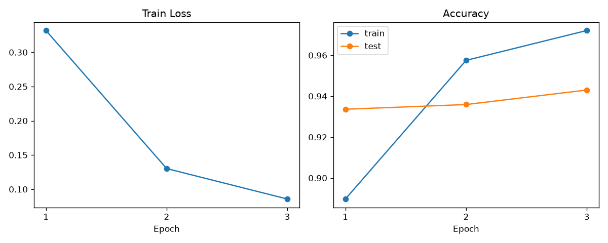

# CIFAR-10 이미지 분류 (ResNet18 전이학습)

ImageNet으로 사전학습된 ResNet18을 CIFAR-10 데이터셋에 맞게 파인튜닝하여 10개 클래스 이미지 분류 모델을 학습했습니다.

**최종 테스트 정확도: 94.30%** (3 에폭, 학습 시간 28.4분)

## 환경

| 항목 | 내용 |
|---|---|
| 기기 | MacBook (Apple M2), MPS(GPU) 사용 |
| Python | 3.12.4 |
| PyTorch / torchvision | 2.15.0 / 0.29.2 |

## 데이터셋

- **CIFAR-10**: 32x32 컬러 이미지, 10개 클래스
- 학습 50,000장 / 테스트 10,000장 (클래스당 학습 5,000장, 테스트 1,000장)
- 클래스: airplane, automobile, bird, cat, deer, dog, frog, horse, ship, truck

## 모델과 학습 방법

- **모델**: ResNet18 (`IMAGENET1K_V1` 사전학습 가중치)
- **전이학습**: 마지막 출력층(fc)만 10개 클래스용으로 교체하고, 전체 네트워크를 함께 미세조정
- **전처리**: 사전학습 모델의 입력 크기에 맞춰 32x32 → 224x224로 리사이즈, ImageNet 평균/표준편차로 정규화
- **데이터 증강**: RandomHorizontalFlip (학습 데이터에만 적용)

| 하이퍼파라미터 | 값 |
|---|---|
| Optimizer | Adam |
| Learning rate | 1e-4 |
| Batch size | 64 |
| Epochs | 3 |
| Loss | CrossEntropyLoss |
| Seed | 42 |

## 결과

### 에폭별 결과

| Epoch | Train Loss | Train Acc | Test Acc | 소요 시간 |
|---|---|---|---|---|
| 1 | 0.3318 | 88.97% | 93.36% | 9분 0초 |
| 2 | 0.1302 | 95.75% | 93.59% | 9분 50초 |
| 3 | 0.0857 | 97.21% | **94.30%** | 9분 35초 |



### 클래스별 테스트 정확도

| 클래스 | 정확도 |
|---|---|
| frog | 98.3% |
| automobile | 97.9% |
| deer | 96.5% |
| ship | 96.3% |
| horse | 96.2% |
| airplane | 93.5% |
| truck | 93.0% |
| bird | 92.5% |
| dog | 89.5% |
| cat | 89.3% |

## 분석

- **사전학습 효과**: 1 에폭만에 테스트 정확도 93.4%를 달성했습니다. ImageNet에서 이미 배운 특징(모양, 질감 등)을 그대로 활용했기 때문입니다.
- **과적합 조짐**: 2 에폭부터 학습 정확도(95.8% → 97.2%)가 테스트 정확도(93.6% → 94.3%)보다 빠르게 올라, 학습 데이터에 점점 맞춰지는 경향이 보입니다.
- **헷갈리는 클래스**: cat(89.3%)과 dog(89.5%)의 정확도가 가장 낮았습니다. 32x32의 작은 이미지에서 생김새가 비슷한 두 동물을 구분하기 어려운 것으로 보입니다.

## 개선 방향

- 에폭을 늘리고 학습률 스케줄러(CosineAnnealing 등)를 적용
- RandomCrop, ColorJitter 등 데이터 증강을 추가해 과적합 완화
- confusion matrix로 cat/dog 오분류 패턴을 자세히 분석
- ResNet50 등 더 큰 모델과 비교

## 실행 방법

```bash
python3 -m venv .venv
source .venv/bin/activate
pip install torch torchvision matplotlib
python train.py
```

데이터셋은 처음 실행할 때 `data/` 폴더에 자동으로 다운로드됩니다.

## 파일 구성

| 파일 | 설명 |
|---|---|
| `train.py` | 데이터 로드, 학습, 평가, 결과 저장 코드 |
| `results.json` | 설정값, 에폭별 결과, 클래스별 정확도 |
| `training_curve.png` | loss / accuracy 학습 곡선 |
| `train.log` | 학습 로그 |
| `model.pt` | 학습된 가중치 (용량 문제로 git에서 제외) |
